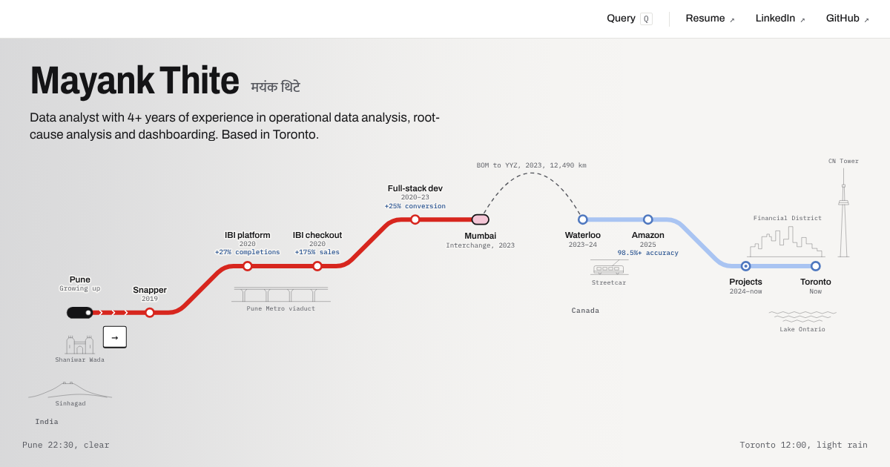
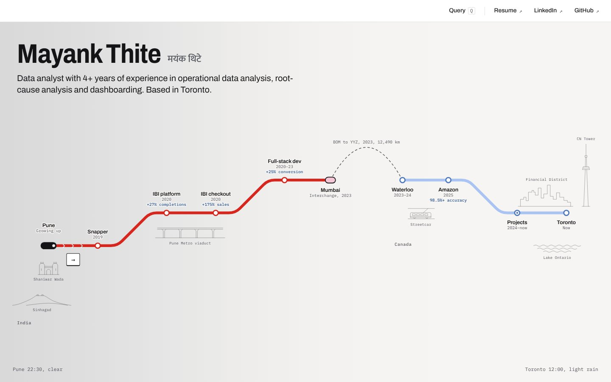
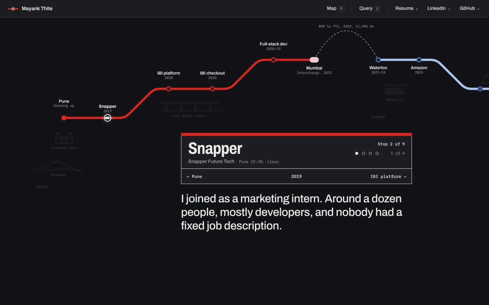
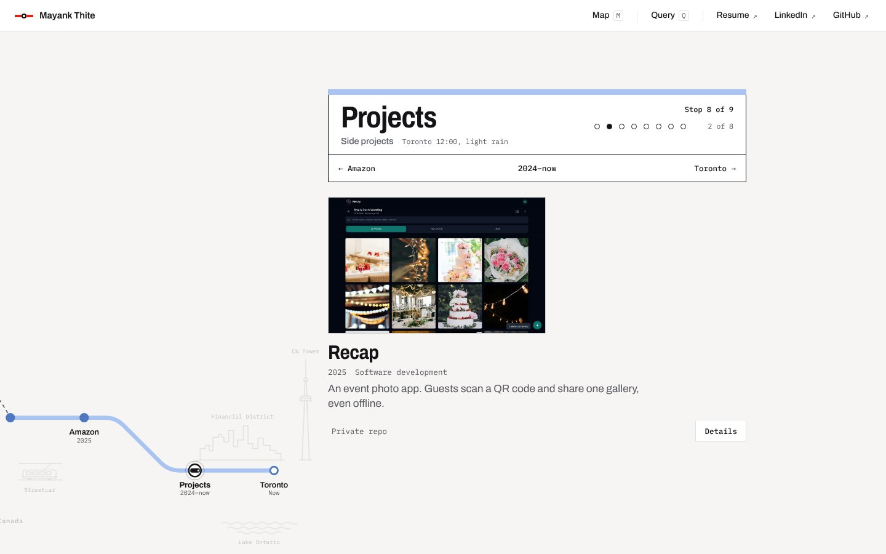

### 👉 [**mayank-thite.github.io**](https://mayank-thite.github.io/)

[**About me**](#-about-me) · [**How to read it**](#-how-to-read-it) · [**Projects**](#-projects) · [**How it's built**](#-how-its-built) · [**Contact**](#-contact)

## 👋 About me

I'm a data analyst with 4+ years of experience in operational data analysis, root-cause analysis and dashboarding. I work with SQL, Power BI and Python, and I'm currently an Operations Analyst at Amazon Canada.

I'm looking for data analyst, BI and junior data engineering roles. I'm based in Toronto and open to roles across Canada.

> [!TIP]
> Short on time? Go straight to [Toronto](https://mayank-thite.github.io/#s9), the last stop. It has the short version, my skills and how to reach me.

## 🧭 How to read it

The site is a metro map of my career, from Pune to Toronto. Each station is a job, a move or a set of projects, and each one has a few platforms with one thing on each.

- **Ride the line.** Swipe, scroll, use the arrow keys or pick any station on the map.
- **Query the line.** Press `Q` to run SQL over the same data the map is drawn from.
- **Local time and weather.** Each station takes the time of day and the current weather of its own city, so Pune can be at night while it snows in Toronto.

<table>
<tr>
<td width="50%" valign="top">

**The map**

</td>
<td width="50%" valign="top">

**A station**

</td>
</tr>
</table>

## 📂 Projects

Every project below has its own platform at the [Projects station](https://mayank-thite.github.io/#s8), with what it's for, how I built it, the problems along the way and what I found.

| Project | What it does | Area | Links |
|:--|:--|:--|:--|
| **Recap** | An event photo app. Guests scan a QR code and share one gallery, even offline. | Software development | |
| **Ask Toronto 311** | Ask a question about Toronto's 311 requests in plain English and get the answer from the data. | Software development, Machine learning | [Repo](https://github.com/Mayank-thite/ask-toronto-311) · [Results](https://mayank-thite.github.io/ask-toronto-311/) |
| **Canada economy pipeline** | A dashboard that refreshes itself every weekday with Canada's rates, inflation, jobs and dollar. | Data engineering, Analytics | [Repo](https://github.com/Mayank-thite/canada-econ-pipeline) · [Dashboard](https://mayank-thite.github.io/canada-econ-pipeline/) |
| **Course drop-off analysis** | Finds when online students drop out and who to call before they do. | Analytics, Machine learning | [Repo](https://github.com/Mayank-thite/course-dropoff-analysis) · [Dashboard](https://mayank-thite.github.io/course-dropoff-analysis/dashboard.html) |
| **Retail analytics engine** | Two years of wholesale sales turned into demand, customer and stock decisions. | Data engineering, Analytics | [Repo](https://github.com/Mayank-thite/retail-analytics-engine) · [Dashboard](https://mayank-thite.github.io/retail-analytics-engine/dashboard.html) |
| **Stock sentiment pipeline** | Streams news headlines and checks whether their tone moves share prices. | Data engineering, Data science | [Repo](https://github.com/Mayank-thite/stock-sentiment-pipeline) · [Dashboard](https://mayank-thite.github.io/stock-sentiment-pipeline/dashboard.html) |
| **Statistics and modeling** | Tests whether a model that picks which bank customers to call beats calling everyone. | Data science, Machine learning | [Repo](https://github.com/Mayank-thite/statistics-and-modeling) |

## 🔧 How it's built

The whole site is one HTML file, `site/index.html`, with plain CSS and JavaScript. There is no build step and no library.

<b>The details</b>

 

- **One source of data.** The stations and projects are two lists in the script. The map, the station signs, the skills list and the query panel are all drawn from them.
- **The map is the navigation.** The line is an SVG path. The camera eases along it with a spring curve, and the train reads its position from a lookup table instead of measuring the path on every frame.
- **Queries run in the page.** The three saved SQL queries are worked out in the browser over the same lists, and the panel shows how long each one took.
- **Time and weather.** The theme comes from each city's local time and its sunrise and sunset. The weather is read from Open-Meteo once the page has loaded and drawn on a canvas that stops when the tab is hidden. If that request fails, the page shows the usual weather for the month instead.
- **Reduced motion.** Anyone who has reduced motion turned on in their system settings gets a still version.
- **Private by default.** Nothing is stored or tracked, and the fonts are served from the site itself. The weather lookup is the only outside request. The email address is put together by the script when the Contact platform opens, so it isn't in the page source, and `robots.txt` asks AI crawlers to stay out.
- **Deploys itself.** Every push to `main` publishes the `site/` folder to GitHub Pages through `.github/workflows/deploy.yml`.

The earlier version of the site, built with React, is kept on the [`old-story-site`](https://github.com/Mayank-thite/mayank-thite.github.io/tree/old-story-site) branch.

## 📬 Contact

The quickest way to reach me is the [Contact platform](https://mayank-thite.github.io/#s9/5) on the site or [LinkedIn](https://www.linkedin.com/in/mayank-thite). My [resume](https://mayank-thite.github.io/Mayank_Thite_Resume.pdf) is on the site too.
