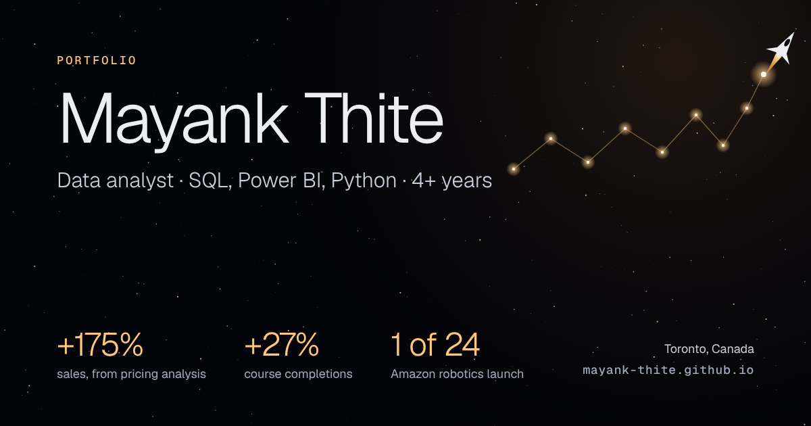
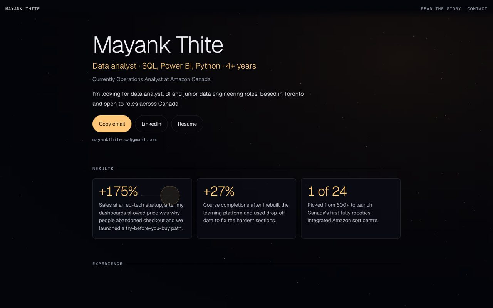
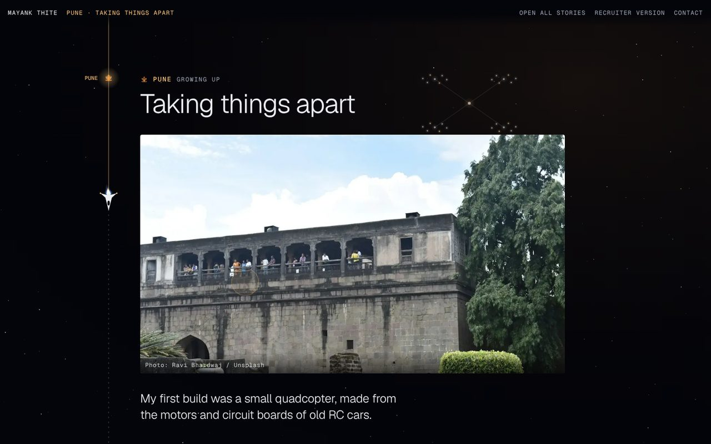

### 👉 [**mayank-thite.github.io**](https://mayank-thite.github.io/)

[**About me**](#-about-me) · [**Two ways to read it**](#-two-ways-to-read-it) · [**Projects**](#-projects) · [**How it's built**](#-how-its-built) · [**Contact**](#-contact)

## 👋 About me

I'm a data analyst working with SQL, Power BI and Python, with 4+ years of experience. I'm currently an Operations Analyst at Amazon Canada.

I'm looking for data analyst, BI and junior data engineering roles. I'm based in Toronto and open to roles across Canada.

> [!TIP]
> Short on time? The [recruiter view](https://mayank-thite.github.io/#hire) has my roles, results, skills and contact details on one page. It takes about a minute.

## 🧭 Two ways to read it

The site opens with a choice. Pick the short version or the long one, and switch between them any time from the top bar.

<table>
<tr>
<td width="50%" valign="top">

**I'm hiring** · about a minute

The roles I'm after, what I've delivered, my skills, my projects and how to reach me.

</td>
<td width="50%" valign="top">

**Walk me through it** · about five minutes

From a quadcopter in Pune to a robotics floor in Ontario, in nine stops. Each one leads with the work, and the backstory is optional.

</td>
</tr>
</table>

## 📂 Projects

Every project below is also on the site, with what it's for, how I built it, the problems along the way and what I found.

| Project | What it does | Area | Links |
|:--|:--|:--|:--|
| **Recap** | An event photo app. Guests scan a QR code and share one gallery, even offline. | Software development | |
| **Ask Toronto 311** | Ask a question about Toronto's 311 requests in plain English and get the answer from the data. | Software development, Machine learning | [Repo](https://github.com/Mayank-thite/ask-toronto-311) · [Results](https://mayank-thite.github.io/ask-toronto-311/) |
| **Canada economy pipeline** | A dashboard that refreshes itself every weekday with Canada's rates, inflation, jobs and dollar. | Data engineering, Analytics | [Repo](https://github.com/Mayank-thite/canada-econ-pipeline) · [Dashboard](https://mayank-thite.github.io/canada-econ-pipeline/) |
| **Course drop-off analysis** | Finds when online students drop out and who to call before they do. | Analytics, Machine learning | [Repo](https://github.com/Mayank-thite/course-dropoff-analysis) · [Dashboard](https://mayank-thite.github.io/course-dropoff-analysis/dashboard.html) |
| **Retail analytics engine** | Two years of wholesale sales turned into demand, customer and stock decisions. | Data engineering, Analytics | [Repo](https://github.com/Mayank-thite/retail-analytics-engine) · [Dashboard](https://mayank-thite.github.io/retail-analytics-engine/dashboard.html) |
| **Stock sentiment pipeline** | Streams news headlines and checks whether their tone moves share prices. | Data engineering, Data science | [Repo](https://github.com/Mayank-thite/stock-sentiment-pipeline) · [Dashboard](https://mayank-thite.github.io/stock-sentiment-pipeline/dashboard.html) |
| **Statistics and modeling** | Tests whether a model that picks which bank customers to call beats calling everyone. | Data science, Machine learning | [Repo](https://github.com/Mayank-thite/statistics-and-modeling) |

## 🔧 How it's built

I built the site myself. The star sky behind it is one canvas with one animation loop, kept outside React so it never slows the page down.

<b>The details</b>

 

- **Fast first load.** The opening page ships on its own. The recruiter view and the story are separate pieces that start loading when you hover or tap a choice, along with their first images. The site only switches views once they're ready, so transitions don't stall.
- **No blank screen.** A small loading screen is built into the HTML, so something shows before any JavaScript runs. It fades once the fonts and the first view are ready.
- **Calm by default for some.** Anyone who has reduced motion turned on in their system settings gets a still version everywhere.
- **Easy to update.** All the text lives in two files (`src/content/stops.js` and `src/content/projects.js`), and images are WebP files in `public/s/`.
- **Deploys itself.** Every merge to `main` is checked, built and published to GitHub Pages by `.github/workflows/deploy.yml`.

## 📬 Contact

The quickest way to reach me is [email](mailto:mayankthite.ca@gmail.com) or [LinkedIn](https://www.linkedin.com/in/mayank-thite). My [resume](https://mayank-thite.github.io/Mayank_Thite_Resume.pdf) is on the site too.
